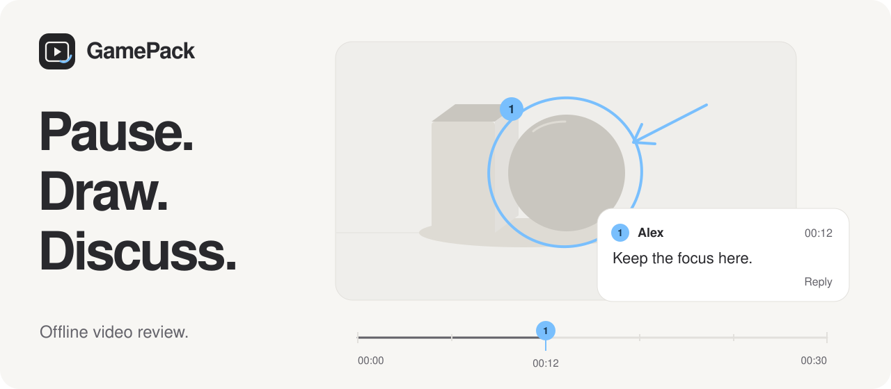

<picture>
  <source media="(prefers-color-scheme: dark)" srcset="docs/assets/readme-dark.svg">
  <source media="(prefers-color-scheme: light)" srcset="docs/assets/readme-light.svg">
  
</picture>

# GamePack

**Point to the moment. Keep the conversation with it.**

GamePack is an offline desktop app for reviewing local video. Pause on a frame, draw what you mean, and attach a comment. Come back in Review mode and playback stops at each conversation, with the drawing right where you left it.

No account, uploads, telemetry, or running server. Your footage and feedback stay on your computer.

[Try it](#try-it) · [How to review](#review-your-first-video) · [Contribute](CONTRIBUTING.md) · [Development](docs/development.md)

> **Pre-MVP · actively being built.** GamePack has a working review flow, but it has not reached MVP. Expect rough edges and changes. Bug reports, testing, design feedback, documentation, and code contributions are welcome.

## What you can do today

| Feature | What it does |
| :--- | :--- |
| **Watch or review** | Play continuously in Watch, or stop at commented frames in Review. |
| **Draw on a frame** | Use a pen, arrow, or ellipse in a single blue ink. Each conversation belongs to one instant. |
| **Keep feedback in context** | Matching numbers connect drawings, floating comment cards, and filmstrip markers. Replies stay in their conversation. |
| **Organize your footage** | Create projects and folders, add local videos, and search the current location. |
| **Focus on the video** | Use fullscreen, frame stepping, playback speed, zoom, and a temporary laser pointer. |
| **Make it comfortable** | Choose System, Light, or Dark appearance and customize keyboard shortcuts. |

The interface keeps the video central: floating controls, a compact filmstrip, and comments beside the moment being discussed. The header artwork illustrates that workflow; it is not an app screenshot.

## Try it

Build from source on `main` to try the current app. Automated builds and releases are paused while development is active.

| Platform | Current path |
| :--- | :--- |
| **macOS 14+** | Local source build for Apple silicon or Intel. Ad-hoc signed; not notarized. |
| **Windows 10 2004+ / 11** | Native host and source-build scripts for x64 and ARM64. Needs native Windows testing; macOS results do not establish Windows parity. |

### macOS

Install Xcode and open it once, then run:

```sh
git clone https://github.com/Potirniche-Carmine/GamePack.git
cd GamePack
git switch main
bash scripts/bootstrap-macos.sh
bash scripts/install-macos.sh
```

The bootstrap script installs missing build tools and project dependencies. The installer builds the app if needed, installs it, and opens it. Later, launch `~/.gamepack/app/GamePack.app` or `~/.gamepack/Launch GamePack.command`. The installed app runs without a terminal or development server.

For Windows setup, rebuilding after changes, or a custom library location, see the [development guide](docs/development.md).

## Review your first video

1. **Add your footage.** Choose **New project**, open it, then **Add video**. Use **New folder** if you want to group videos inside the project.
2. **Find the moment.** Play with **Space**, pause, then use **← / →** to step through frames. Switch to **Review** to draw and comment.
3. **Show what you mean.** Choose **Pen**, **Arrow**, or **Ellipse** and draw on the frozen frame. Add text, then choose **Post**. Set your display name when prompted.
4. **Follow the conversation.** Select a numbered marker or comment to return to its frame. Choose **Reply** to continue the discussion; replies can be text-only.
5. **Watch it back.** **Review** stops at commented frames until you press Play. **Watch** hides the review overlays and plays continuously. Press **R** to switch modes.

A new conversation requires a drawing. Posted comments cannot be edited or individually deleted; deleting their video or project removes them. Post or discard a new conversation before leaving its frame: draft recovery is still incomplete. See the [review guide](docs/reviewing.md) for the details.

<details>
<summary><strong>Useful keyboard shortcuts</strong></summary>

| Action | Default |
| :--- | :--- |
| Play / pause | `Space` |
| Switch Watch / Review | `R` |
| Previous / next frame | `←` / `→` |
| Seek five seconds | `Shift` + `←` / `→` |
| Shuttle backward / stop / forward | `J` / `K` / `L` |
| Pen / arrow / ellipse | `P` / `A` / `E` |
| Pointer / temporary laser | `V` / `B` |
| Post comment | `⌘` / `Ctrl` + `Enter` |
| Undo drawing | `⌘` / `Ctrl` + `Z` |
| Redo drawing | `⌘` / `Ctrl` + `Shift` + `Z` |
| Fullscreen | `F` |
| Zoom in / out / fit | `+` / `−` / `0` |
| Open settings | `⌘` / `Ctrl` + `,` |

Use **Settings** to search and change bindings. Drawing and review shortcuts apply in Review mode. Existing custom bindings take precedence.

</details>

## Your library stays local

GamePack copies imported video into its managed library and leaves the original file untouched. Drawings and comments are stored separately; they are not burned into your footage.

Application-owned data lives in `~/.gamepack` on macOS or `%USERPROFILE%\.gamepack` on Windows. Set `GAMEPACK_HOME` to use another absolute path. Close GamePack before backing up that folder.

Deleting a video or project removes its comments and drafts, but keeps managed media on disk. It does not reclaim that media's storage space.

## Help shape GamePack

You do not need to write code to contribute. Try the review flow, report a confusing interaction, reproduce a bug, improve these docs, or help verify Windows behavior.

- [Report a bug or suggest an improvement](https://github.com/Potirniche-Carmine/GamePack/issues).
- Read [Contributing](CONTRIBUTING.md) for useful starting points and how to submit a change.
- Read [Development](docs/development.md) for setup, checks, and the codebase map.

ZIP import/export, live collaboration, narrated walkthroughs, mobile and Linux apps, and signed consumer installers are not available. The [implementation plan](GamePack-Implementation-Plan-v3.md) contains longer-term ideas and historical design notes; it is not a list of shipped features.

## License

[MIT](LICENSE). Third-party dependencies retain their own licenses.
