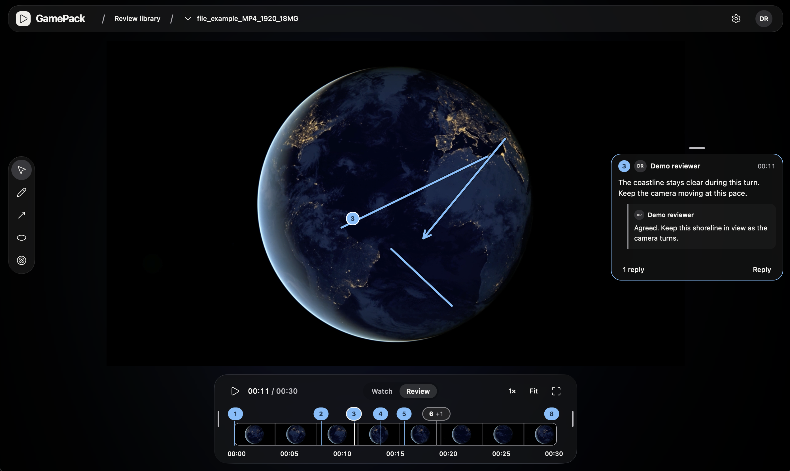

# GamePack

An offline desktop app for reviewing video. Organize footage into projects, draw on a frame, and leave comments and replies. Review mode pauses at commented frames. Everything stays on your computer.



[Patch notes](CHANGELOG.md)

## Built with

- **React Native + TypeScript** — shared desktop interface.
- **Rust + SQLite** — local library, media imports, and comments.
- **AVPlayer / MediaPlayer** — native playback on macOS and Windows, with a CXX bridge to Rust.

## Run locally

On macOS 14+, install Xcode and open it once, then:

```sh
git clone https://github.com/Potirniche-Carmine/GamePack.git
cd GamePack
git switch main
bash scripts/bootstrap-macos.sh
npm run app:install
```

[Windows setup, tests, and codebase guide →](docs/development.md)

## Contributing

Contributions are welcome, including bug reports, fixes, and platform testing. See [Contributing](CONTRIBUTING.md) to get started.

## License

[MIT](LICENSE)
